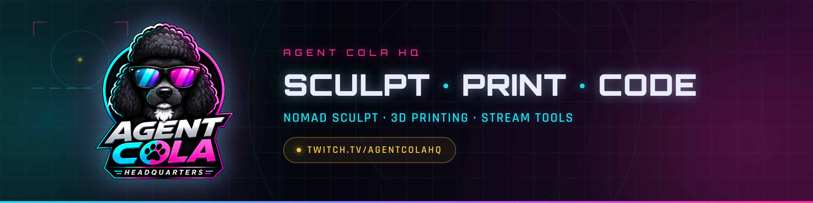

## Hey, I am Jeri. I run Agent Cola HQ.

**Come for the 3D, stay for the chaos.**

I stream 3D sculpting, 3D printing, drawing, and the building of my own stream tools at [twitch.tv/agentcolahq](https://twitch.tv/agentcolahq). My codename on the channel is Agent Fizzy Cipher. The mascot is Cola, my poodle. Belle the cat takes over when she feels like it.

Almost everything in this account started as something my stream needed and did not have yet. I build these with AI as my assistant, and I am learning the code as I go. The goal is to get to where I am making my own work instead of asking someone else for it.

---

### What I am building

| Project | What it does |
| --- | --- |
| [**cola-animator-releases**](https://github.com/AgentColaHQ/cola-animator-releases/releases/latest) | Cola Animator, my desktop animation app. Downloads live here. |
| [**firebot-openai-chat**](https://github.com/AgentColaHQ/firebot-openai-chat) | Hooks an AI chat response into Firebot for the stream. |
| [**SpotifyNowPlaying**](https://github.com/AgentColaHQ/SpotifyNowPlaying) | Now Playing readout for my OBS overlay. |
| [**agentcolahq.github.io**](https://agentcolahq.com) | The HQ hub site. Radar map background, project case files, music player. |

---

### Find me

**WATCH**

**HANG OUT**

**MAKES**

**SUPPORT**

---

### Stream schedule

**Tuesday, Friday and Saturday at 8:00 PM Central**, live on [Twitch](https://twitch.tv/agentcolahq).

Every stream is either Nomad Sculpt or coding. Which one it is depends on the day.

---

### What I am learning right now

- Writing more of my own code instead of only directing it.
- HTML and CSS, so the site and the overlays are mine.
- Blender, on top of the Nomad Sculpt work I already do.
- Animation, which is how Cola Animator started in the first place.

I am fine with the early results being rough. They are mine, and that is the point.
